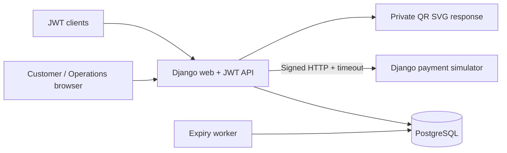

# TicketFlow architecture — UFARM-3845

## Service boundary

The payment simulator is independently runnable, has its own settings/routes and does not import booking models or access the booking DB. It returns deterministic synthetic references; it does not move money or keep a payment ledger. The booking service records accepted simulated payments atomically with tickets.

Events, seats, bookings and tickets deliberately remain in one Django service. Splitting seat allocation and ticket creation into separate databases at this stage would require durable outbox delivery, idempotent consumers, sagas and reconciliation. Five containers sharing mutable tables would not provide that isolation. This implementation is a two-service MVP, not a claim that each domain is an autonomous microservice.

## Reservation invariants

1. Reservations first lock the customer to serialize per-customer idempotency and active-hold checks; all inventory mutations then acquire `SELECT FOR UPDATE` on the event. Booking state changes then acquire the booking lock. This common lock order avoids inverted-lock deadlocks.
2. Reserve releases stale holds, validates ownership of all requested seats, calculates UZS integer prices from DB and assigns seats in a transaction. No client-provided amount is accepted.
3. The seat has one current reservation pointer. BookingSeat preserves historical seat and price information after expiry/release.
4. A hold lasts ten minutes. The worker sweeps every 15 seconds; booking/detail/payment paths also check expiry, so worker delays do not allow late payment.
5. Remote payment I/O runs outside DB locks with a four-second timeout. Afterward the service reacquires locks and rechecks state and expiry.
6. Payment has a unique booking relation and reference; Ticket has a unique booking-item relation. Repeated approval requests return the existing paid booking.
7. Check-in locks the ticket and changes it exactly once. It requires staff permission and a CSRF-protected POST.

Per-event serialization favors correctness and simplicity; a popular event may become a contention hotspot. PostgreSQL concurrency tests cover one seat contested by two users. Larger-scale inventory requires narrower deterministic seat locks, load tests and retry handling for deadlocks/serialization failures.

SQLite does not provide these row-lock guarantees and is only for single-user development.

## Payment boundary

Web signs the exact JSON body using HMAC-SHA256 and PAYMENT_SECRET. Payment validates signature, UUID, amount, currency and outcome. Approval references are derived from booking ID + amount + UZS, so retries return the same result. Simulator state is intentionally not a real financial system.

If a reservation expires or is cancelled while HTTP approval is in flight, the booking service issues no ticket. There is no real charge to reverse. A real PSP integration must persist attempts, verify callbacks, reconcile unknown outcomes and compensate late approvals; replacing the simulator URL alone is insufficient.

## Access and administration

- Web: Django sessions and CSRF. API: short-lived SimpleJWT access token + refresh token.
- Customers access only their own booking, QR and calendar resources.
- Operations requires active staff membership. Staff must also hold the relevant Django permissions. Event managers, Booking operators, Gate staff and Auditors are configured by `setup_roles`; only superusers bypass individual checks. Permissions are platform-wide, not organizer/event-scoped.
- Custom forms manage event metadata and initial seats. Existing financial records cannot be directly edited through technical admin.
- Static assets are served by WhiteNoise under Gunicorn. No third-party JS, fonts or poster-image requests are needed.
- No default administrator credentials are created.

## Deployment components

Compose contains `db`, `migrate`, `web`, `payment` and `expiry-worker`. Web/worker wait for migration success. Health endpoints distinguish process health and DB readiness. Readiness does not include payment availability: browsing remains useful when the simulator is down and checkout shows a retry message.

CI installs dependencies, checks migrations, runs PostgreSQL tests, exercises signed HTTP payment, collects static assets and builds the image. Dependencies are version-range constrained, not a resolved/hash-locked production supply chain. Resolve and audit a lockfile before production promotion.

## Reliability and operations revision

Reservation retries may supply a UUID `Idempotency-Key` (web forms supply their own hidden UUID). A DB unique constraint on customer/key and customer-row locking guarantee a replay returns the existing reservation. Reusing the key with a different event/seat set returns `idempotency_conflict`; expired replays return the expired state and release inventory. Active holds are limited to three per customer.

PaymentAttempt records processing, approved, failed and abandoned outcomes. A minute-window guard rejects additional attempts after ten recent attempts on one booking; this guard is not a strict distributed rate limiter. In-flight process crashes may leave a started attempt for investigation. AuditLog captures reservation/payment/event/check-in actions; application admin is read-only, but these records are not a cryptographically tamper-proof ledger.

Event posters are validated raster uploads (JPEG/PNG/WebP, at most 5 MB and 20 MP). `/events/{id}/poster/` works with DEBUG disabled and prevents unauthorised draft-poster access. Compose persists uploads in a named volume. Configure CDN/storage lifecycle and backup policy for a production rollout.
